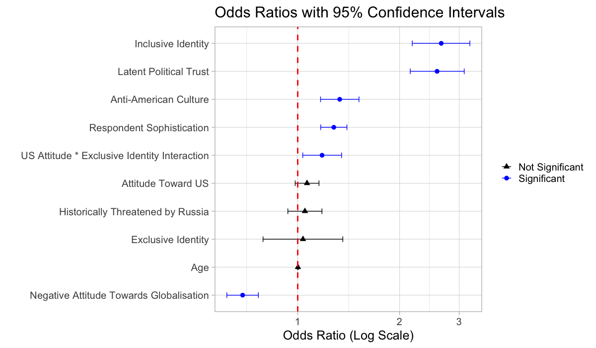
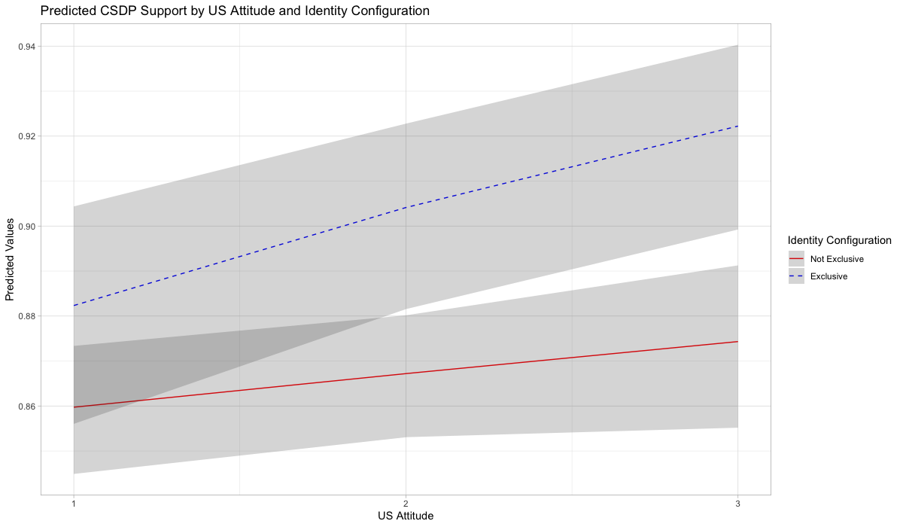

# Make CSDP Great Again: Trump's rhetoric and public support for EU defence policy

My BSc thesis in International Relations and Organisations at Leiden University (2024, supervisor Nikoleta Yordanova). It asks:

> To what extent did individual evaluations of Trump's campaign rhetoric affect support for the EU's Common Security and Defence Policy (CSDP) in joint EU/NATO member states, in the immediate aftermath of the 2016 US presidential election?

- **Full text:** [thesis/Saldan_2024_Make_CSDP_Great_Again.pdf](thesis/Saldan_2024_Make_CSDP_Great_Again.pdf)
- **Analysis code (R Markdown):** [analysis/analysis.Rmd](analysis/analysis.Rmd)

## Approach

The thesis combines rational-choice accounts of defence attitudes with the affective reasoning model from political psychology. It tests two hypotheses:

- **H1:** negative evaluations of the USA increase support for CSDP.
- **H2:** this effect does not hold for people with an exclusively national identity.

The models are logistic regressions of CSDP support on attitude towards the US, reported as odds ratios. There are five specifications:
1. bivariate;
2. with controls;
3. with an interaction between US attitude and exclusive national identity;
4. interaction plus controls (the main model);
5. interaction with country fixed effects.

The controls are political trust, attitudes to globalisation, political sophistication, age, a country's historical threat from Russia, and cultural attitudes to the US. The code also covers scale building (Mokken scaling), checks of model assumptions (linearity of the logit, residuals, influential cases, multicollinearity) and model comparison.

## Findings

The results ran against both hypotheses. In the immediate aftermath of the election, CSDP support went with **positive** rather than negative attitudes towards the US. The thesis discusses possible explanations, such as an underlying "anti-superpower" sentiment (Lawson and Hudson, 2015). It also sets out the limits of the design.

The full regression table for all five models is in [figures/regression_table.png](figures/regression_table.png).

## Data

The analysis uses **Eurobarometer 86.2 (November 2016)**, a cross-national survey run for the European Commission.

- Fieldwork: 3–14 November 2016, which spans the US election on 8 November.
- Respondents interviewed before 9 November were dropped.
- Only countries in both the EU and NATO are kept.
- "Don't know" answers are treated as missing.

The survey data are **not included in this repository**. They are distributed by the GESIS Data Archive under its own terms of use. To run the analysis:

1. Download **ZA6788, dataset version 2.0.0** (Stata format) from GESIS: <https://search.gesis.org/research_data/ZA6788> (DOI [10.4232/1.13602](https://doi.org/10.4232/1.13602)). A free GESIS account is required.
2. Save the file as `data/ZA6788_v2-0-0.dta`.
3. Open `analysis/analysis.Rmd` in RStudio with the `analysis/` folder as the working directory and knit it. The packages are listed at the top of the file.

## Notes

The analysis code is published as it was used for the thesis (autumn 2024), apart from the data path.
